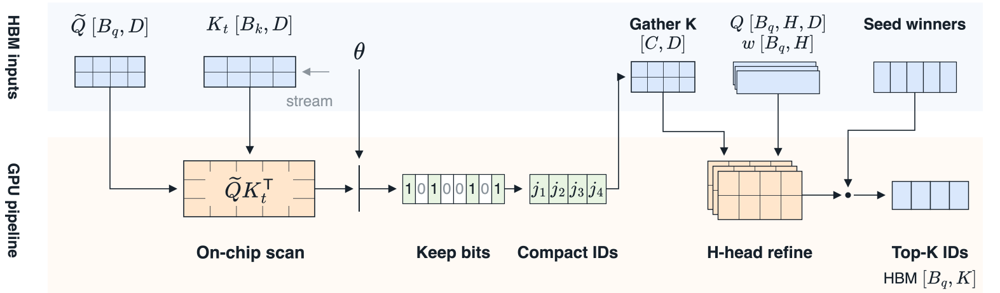

Sparse attention attends to a few hundred keys out of a million. Picking those keys is the expensive part. [DeepSeek Sparse Attention](https://arxiv.org/abs/2512.02556) routes selection through a multi-head *indexer* that scores every visible key with every head, so the attention is sparse while the search that feeds it stays dense. At 1M tokens on GLM-5.2, that search takes 72% of prefill GPU time.

Work on this bottleneck splits along the dimension it attacks. [IndexCache](https://arxiv.org/abs/2603.12201) reuses index decisions across layers, so the search runs less often. [LiteTopK](https://arxiv.org/abs/2607.11976) fuses scoring with selection to cut memory traffic. [HISA](https://arxiv.org/abs/2603.28458) screens pooled blocks first, shrinking where the search looks, and [MISA](https://arxiv.org/abs/2605.07363) routes a subset of indexer heads per query, shrinking how many heads it uses. What survives all of these is the per-key operation itself: a head-wise ReLU dot product, evaluated wherever token scores are still needed.

[DoSA](/blog/dosa/) made that operation conditional: bound a key's score from a few heads, and reject it outright when the bound falls below a threshold the seed keys already guarantee. Rejection is certified, so the Top-K never changes.

DoSA++ attacks the same bottleneck from the other side. Instead of bounding what it skips, it predicts what to keep. One dot product per key proposes a candidate set; the original multi-head scorer then ranks those candidates. The prediction is cheap because of a structural fact about the indexer: ReLU makes it piecewise linear, so once the activation pattern is fixed, every head collapses into a single vector.

The pattern is not known in advance, but it can be estimated. DoSA++ samples a few hundred keys per query, scores them with the full indexer, and measures how often each head fires among the highest-scoring ones. Those rates become the coefficients of one folded query, which carries every head's original signed weight and its estimated activation rate near the part of the score distribution that decides selection. The broad scan then costs one dot product per key instead of $H$, and full-head scoring is reserved for the seed keys and the surviving candidates.

This separates a broad, inexpensive search from a small, expressive ranking stage. Nothing is retrained: the folded direction is rebuilt per query from the pretrained indexer parameters and whatever is currently in the key cache.


2.35× | Faster time to first token | GLM-5.2-FP8 at 1M tokens, TP8; 131.4 s to 56.0 s
8.01× | Faster complete Indexer | Best of 60 microbenchmark configurations
99.96% | Token-set recall on RULER | 99.90% on LongBench v2, against native DSA
53.28% | LongBench v2 accuracy | Above native DSA's 52.49%, with RULER unchanged


## The score is piecewise linear

For one query, let $\mathbf q_h \in \mathbb R^D$ be head $h$, $w_h$ its weight, and $\mathbf k_i$ the key at position $i$. With $[x]_+ = \max(x, 0)$, the indexer score over the visible keys $\Omega$ is

$$
s_i = \sum_{h=1}^{H} w_h \left[\mathbf q_h^\top \mathbf k_i\right]_+ , \qquad i \in \Omega. \tag{1}
$$

The indexer returns the $K$ highest-scoring keys. Weights can be positive or negative: a positive head raises the score when it fires, a negative head lowers it.

Write the head dot product and its gate separately, $x_{hi} = \mathbf q_h^\top \mathbf k_i$ and $A_{hi} = \mathbf 1[x_{hi} > 0]$, and the score becomes $s_i = \sum_h w_h A_{hi} x_{hi}$. Freeze the gates at some pattern $a_h$ and the sum turns linear in the key:

$$
\sum_{h=1}^{H} w_h a_h \, \mathbf q_h^\top \mathbf k_i = \left(\sum_{h=1}^{H} w_h a_h \mathbf q_h\right)^{\!\top} \mathbf k_i . \tag{2}
$$

The $H$ dot products on the left become one on the right. The catch is that the gates depend on the key, which is what we are trying to avoid computing. So we need a gate pattern good enough to rank keys, available before the scan starts.

## Estimate the gates where ranking happens

Selection only cares about the top of the score distribution. A head that fires on low-scoring keys and stays quiet on high-scoring ones is irrelevant to the Top-K, however often it fires overall. So DoSA++ estimates gates on the keys that matter.

Per query, it samples $m_a = 512$ evenly spaced positions, scores them with the full multi-head indexer, and keeps the top $\rho = 2\%$ by score, ties included, as a set $\mathcal T$. Each head's activation rate is its firing frequency on that set:

$$
\widehat p_h = \frac{1}{|\mathcal T|} \sum_{j \in \mathcal T} \mathbf 1\!\left[\mathbf q_h^\top \mathbf k_j > 0\right] . \tag{3}
$$

Ranking the samples by the original signed score means both the positive contributions and the negative penalties shape which keys end up in $\mathcal T$. A head that fires throughout the high-score region gets a rate near one, a head that never fires gets near zero, and an intermittent head lands in between.

Substituting rates for gates gives the folded query and the predicted score:

$$
\widetilde{\mathbf q} = \sum_{h=1}^{H} w_h \widehat p_h \mathbf q_h , \qquad \widetilde s_i = \widetilde{\mathbf q}^\top \mathbf k_i . \tag{4}
$$

Every head contributes, with its original signed weight intact; only the gates are approximated. There is no ReLU after the dot product — the head-wise ReLUs are already represented in the rates. On the GPU the folded vector is packed into FP8 with its own scale.

 falls below the seed threshold, leaving the true scores (squares) uncomputed. DoSA++ estimates activation rates from the high-scoring tail of 512 probes, folds all $H$ heads into one direction, and ranks keys with one dot product each. Both refine candidates with the original scorer.")
{.wide}

The prediction error, before quantization, is exactly

$$
s_i - \widetilde s_i = \sum_{h=1}^{H} w_h (A_{hi} - \widehat p_h) \, \mathbf q_h^\top \mathbf k_i . \tag{5}
$$

Each term is a head's weight times how far its true gate sits from the estimated rate. Calibrating on high-scoring keys shrinks the error where ordering decides the outcome, and lets it grow freely among keys that were never going to be selected.

### Folding is not head selection

Dropping heads and folding heads are different operations. A subset scorer evaluates a few heads and ignores the rest, so the omitted heads contribute nothing — which is why DoSA has to bound them to stay exact, and why reranking cannot recover a key the screen discarded.

[LiSA](https://github.com/MuLabPKU/TransArch/blob/main/LISA/lisa.pdf) folds instead of drops. Applying $\mathrm{ReLU}(x) = x + \mathrm{ReLU}(-x)$ splits the score exactly into a linear term plus a head-wise correction; since all heads share one key, the linear term collapses into a single dot product. LiSA ranks keys by that term alone and omits the correction, which is equivalent to fixing every gate at one.

DoSA++ keeps the same one-dot-product-per-key budget but sets each gate to its estimated rate $\widehat p_h$ instead of to one. A head that rarely fires near the top of the distribution is scaled down rather than counted in full. The estimate costs 512 full-head probes per query, and in exchange the folded direction adapts to the query and its current key cache.

## Scan, then refine

Candidate selection needs a cutoff. DoSA++ scores $m_r = 4096$ further evenly spaced probes with the folded query and reads off a threshold $\theta$ targeting a candidate budget, then keeps every visible key with $\widetilde s_i \ge \theta$. The surviving set is capped per query before grouped queries share it.

Alongside the scan, a seed pool of $S \ge K$ visible keys is scored with the original $H$-head indexer; its Top-K winners $\mathcal B$ enter selection directly. The candidates $\mathcal C$ that survive filtering are then scored with the original rule, Equation&nbsp;(1), and the output is

$$
\mathcal O = \operatorname*{TopK}_{s}\left(\mathcal B \cup \mathcal C\right) . \tag{6}
$$

Two thresholds do different jobs here. The scan cutoff $\theta$ proposes candidates from predicted scores; the seed threshold discards *computed* original scores that already fall below the $K$-th seed score, which trims the final selection. Ranking always uses the original score, so an approximate scan cannot distort the ordering of what it proposes — it can only fail to propose something.

That is the honest trade. DoSA's rejections are certified: its Top-K is exactly the full scan's. DoSA++ gives up the certificate for a cheaper broad pass, and pays for it in recall — about one to two missed keys per query out of 2,048, as measured below.

## GPU execution

{.wide}

For $M$ queries and $N$ keys the folded queries form an $M \times D$ matrix. Each thread block holds a query tile $\widetilde Q_i \in \mathbb R^{B_q \times D}$ and streams key tiles through a shared-memory ring buffer while Tensor Cores compute $\widetilde S_{ij} = \widetilde Q_i K_j^\top$. Accumulators never leave the chip: SIMT threads apply scales, visibility masks, and per-query cutoffs, then pack the decisions into a bitmap. The scan writes bits, not scores.

Compaction converts the bitmap into candidate IDs. Grouped queries share candidate pages and reuse gathered key tiles, so a key that several queries want is fetched once. Refinement from that point on uses the original query tensors, weights, ReLUs, and reduction; the folded query appears nowhere in it.

Dense indexing costs $\Theta(MNHD)$ dot-product work. DoSA++ spends

$$
\underbrace{M m_a H D}_{\text{gate calibration}} + \underbrace{M m_r D}_{\text{cutoff calibration}} + \underbrace{M (N - S) D}_{\text{folded scan}} + \underbrace{M S H D}_{\text{seed scoring}} + \underbrace{M \bar C H D}_{\text{refinement}} , \tag{7}
$$

where $\bar C$ is the average number of non-seed candidates scored per query after sharing. Only the $N$-sized term is multiplied by the full context, and that term has lost its factor of $H$. Everything still carrying $H$ is sized by $m_a$, $S$, or $\bar C$, all of which stay fixed as the context grows. The memory path splits the same way: a compact bitmap from the scan, gathered keys in refinement, and a small set of original-score records for selection.

## Results

We evaluate GLM-5.2-FP8 under [SGLang](https://arxiv.org/abs/2312.07104) with eight-way tensor parallelism and 16K-token prefill chunks. The baselines are native DSA as SGLang implements it, [LiSA](https://github.com/MuLabPKU/TransArch/blob/main/LISA/lisa.pdf) with its head-fused linear score, and [HISA](https://arxiv.org/abs/2603.28458), which screens 128-token blocks hierarchically before refining inside the survivors. Runtime measurements use a 6K candidate target; quality measurements use 8K.

### Prefill

At 1M tokens, time to first token falls from 131.4 to 56.0 seconds, a 2.35× speedup. The indexer and Top-K kernels run 4.98× faster, which drops their share of prefill GPU time from 72% to 35%.


Prefill GPU time by component on a 1M-token input, averaged over the eight tensor-parallel ranks. Labels on the indexer segment give its share of the total. Attention and FFN kernel times are unchanged, as expected — only selection got cheaper. After the speedup, selection costs about as much as the attention it feeds.


The complete-Indexer microbenchmark replays the DoSA paper's captures: two English, two Chinese, and two code inputs, five context lengths, four chunk sizes, and all 21 indexer-producing layers. Each cell is the median of six CUDA-event repetitions over the whole indexer, including projections, RoPE, quantization, cache stores, retrieval, and selection.


Complete-Indexer speedup over SGLang. DoSA++ wins all 60 configurations, from 1.13× at 128K to 8.01× at 1M. DoSA's bars are its published measurements against its own paired baseline, so the two methods are each normalized to their own SGLang run rather than measured head-to-head.


At 1M tokens with 16K chunks the speedups are 7.63×, 7.51×, and 7.57× for English, Chinese, and code. Context length drives the gain far more than chunk size does: with English inputs and 16K chunks the speedup climbs from 1.14× at 128K to 7.63× at 1M, while growing the chunk eightfold at 1M moves it from 4.85× to 8.01×. Equation&nbsp;(7) predicts exactly this — longer contexts add keys, and keys are what the folded scan made cheap.

### Retrieval fidelity

An approximate scan is only useful if the keys it proposes are the ones the original indexer would have chosen. We measure token-set recall against native DSA: with $\mathcal T$ the reference selection and $\widehat{\mathcal T}$ the approximate one, $\operatorname{Recall} = |\widehat{\mathcal T} \cap \mathcal T| / |\mathcal T|$.


Token-set recall on GLM-5.2 with an 8K candidate budget. [RULER](https://arxiv.org/abs/2404.06654) uses 7,800 examples per model, 1,300 at each of six context lengths; [LongBench v2](https://arxiv.org/abs/2412.15204) uses 503 multiple-choice questions with greedy decoding. DoSA++ holds above 99.88% at every length, while LiSA's recall falls as the context grows.


Mean recall is 99.96% on RULER and 99.90% on LongBench v2. At $K = 2048$ that is roughly 0.7 and 2.0 missed keys per query. LiSA reaches 96.83% at 128K on RULER and 94.36% on LongBench v2's long inputs, where the same arithmetic gives 65 and 116 missed keys.

Downstream quality follows. RULER is statistically unchanged, and LongBench v2 accuracy is slightly higher:

| Method | RULER | LongBench v2 |
| :--- | ---: | ---: |
| Native DSA | 97.59 | 52.49 |
| LiSA | 97.50 | 52.49 |
| **DoSA++** | **97.56** | **53.28** |
{caption="GLM-5.2 RULER score and LongBench v2 accuracy (%). The 0.80-point LongBench v2 gain is four more correct answers out of 503 — within noise at this sample size, and reported here to show that an 8K candidate budget costs nothing measurable, not as evidence that approximation helps."}

To compare against HISA on identical inputs, we replay captured prefill queries: four long-context inputs per model across all indexer layers, 544 queries in total, at about 1M tokens for GLM-5.2 and 512K for Dots3 Note Preview. HISA runs at both its 8K candidate budget and its 4:1 block-compression setting.


Layer-wise recall on captured prefill queries, each curve averaging four inputs. DoSA++ stays near the reference across depth on both models; the block-screening and linear-fold baselines vary by tens of points from layer to layer.


DoSA++ averages 99.50% on GLM-5.2 and 97.47% on Dots3. HISA reaches 42.28% with 8K candidates and 86.32% with 4:1 compression, and LiSA reaches 70.44%, on the same GLM-5.2 queries. The gap is wider on Dots3: 97.47% against 34.70%, 79.65%, and 44.27%.

Two things explain the spread. Block screening commits to a region before looking inside it, so a single high-scoring key in an otherwise unremarkable block can be lost with the block. And LiSA's recall varies with how far the omitted nonlinear correction moves the ranking in each layer, which is exactly what the estimated rates in Equation&nbsp;(4) are meant to absorb.

## What this shares with DoSA, and what it does not

Both methods run a cheap broad pass, compact the survivors, score them with the original indexer, and merge with independently scored seed keys. The pipelines are the same shape, and the final ranking in both is the original multi-head score.

The broad pass is where they part. DoSA computes an upper bound and rejects only when the bound proves the key cannot win; its output is exactly the full scan's Top-K, and its speedup is limited by how tight those bounds are. DoSA++ predicts scores from one folded direction and accepts a small recall loss; the prediction has no guarantee attached, and the gain is correspondingly larger.

Which trade is right depends on whether exactness is a requirement or a preference. DoSA++ needs no retraining and reuses the pretrained indexer parameters as they are, so the choice is a serving-time one.

## Limitations

The recall numbers measure agreement with native DSA's selection, not task accuracy, and the two benchmarks here are not sensitive enough to resolve a sub-percent difference in downstream quality. A 0.80-point LongBench v2 gain on 503 questions is four answers; we report it to show the budget is sufficient, not to claim approximation improves the model.

Calibration assumes the high-scoring tail of 512 probes represents the high-scoring region of the whole cache. Inputs whose relevant keys cluster in a region those probes miss would get a worse folded direction, and the failure mode is silent — a missing candidate leaves no trace in the output. The method also scans every key, so short contexts cannot amortize the calibration cost, and the per-query probes are pure overhead when $N$ is small.

A segmented variant could estimate rates separately per region, which would help when activation structure varies across the context. The design here uses one direction per query.
