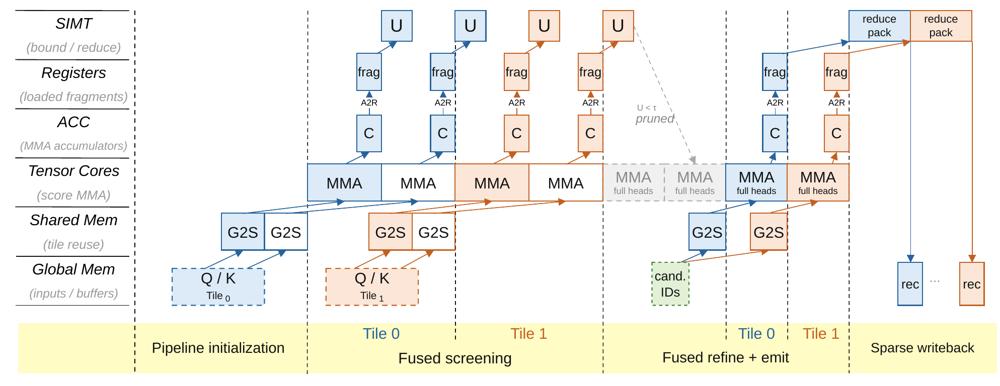
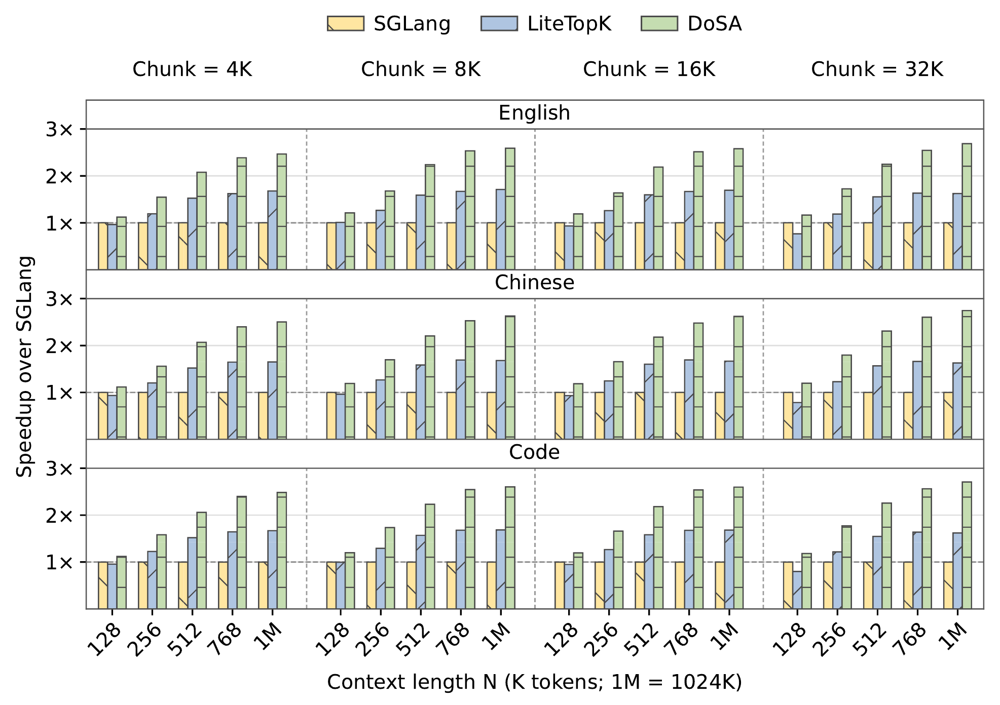
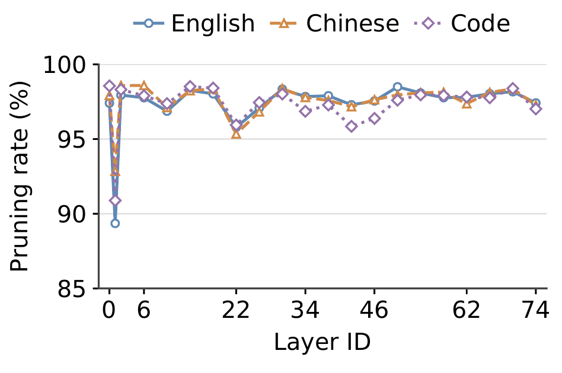

Mixture-of-experts models made feed-forward layers conditional: each token pays for a few experts, not all of them. Sparse attention promises the same for attention, since each query reads only a small set of keys. In practice the promise stops short. DeepSeek Sparse Attention (DSA) picks those keys with a multi-head *indexer*, and the indexer scores **every** visible key with **every** indexer head before taking the Top-$K$. The attention is sparse; the selection is dense.

DoSA (Dots Sparse Attention) makes the selection conditional too. It computes a cheap upper bound on each key's indexer score and rejects every key whose bound is already below the winning threshold. Only the survivors are scored in full. Nothing is approximated: the bound is a proof, so the Top-$K$ is exactly what full scoring would return.


2.74× | Faster Indexer than SGLang | Best of 60 prefill configurations; up to 1.69× over LiteTopK
1.94× | Faster time to first token | DeepSeek-V3.2 at about 1M tokens; 1.86× on GLM-5.2
97% | Query–key pairs rejected | Before any full scoring; domain averages 97.2–97.5% on GLM-5.2
Exact | Top-K selection | The same tokens as scoring every key, by construction


## The indexer becomes the bottleneck

For a query with $H$ indexer heads, let $\mathbf{q}_h$ be the $h$-th query vector, $w_h$ its weight, and $\mathbf{k}_i$ the key of token $i$. The indexer score is a signed, weighted sum of ReLU'd dot products:

$$
s_i = \sum_{h=1}^{H} w_h \left[\mathbf{q}_h^\top \mathbf{k}_i\right]_+ , \qquad i \in \Omega, \tag{1}
$$

where $[x]_+ = \max(x, 0)$ and $\Omega$ is the set of visible keys. The model attends to the $K$ keys with the highest scores.

Each score is cheap, but there is one for every key, and the number of keys grows with the context. At about a million tokens the indexer takes most of prefill:


{
  "type": "bars",
  "unit": "%",
  "y": "Share of prefill time",
  "x": "Prompt length",
  "yMax": 100,
  "label": "last",
  "categories": ["64K", "128K", "256K", "375K", "512K", "768K", "~1M"],
  "series": [
    { "name": "GLM-5.2", "slot": 2, "values": [13.7, 23.6, 38.8, 48.3, 56.2, 66.9, 73.0] },
    { "name": "DeepSeek-V3.2", "slot": 4, "values": [42.6, 56.3, 69.4, 75.2, 80.8, 87.6, 90.8] }
  ]
}


Recent work speeds up the selection step. Guess-Verify-Refine exploits temporal correlation during decoding, DeepSelect streams scores through a bounded buffer, and LiteTopK fuses scoring with candidate filtering so dense scores are never written out. All of them still evaluate every head for every key. MISA screens with fewer heads and reranks with the full indexer, but reranking cannot recover a winner the screen threw away. The question DoSA asks is narrower: can we skip full scoring for a key while *proving* the skip loses nothing?

## Rejecting a key without scoring it

The principle comes from classical document retrieval, where MaxScore and WAND skip documents whose best possible score cannot beat the current top results. A token cannot enter the Top-$K$ if an upper bound on its score is below a lower bound on the Top-$K$ threshold.

The lower bound is easy. Score any subset $\mathcal{S}$ of at least $K$ visible keys in full and take their $K$-th largest score, $\tau = \tau_K(\mathcal{S})$. Those $K$ keys are witnesses: the true threshold over all keys can only be higher. So for any key with an upper bound $U_i$,

$$
\tau_K(\mathcal{S}) \le \tau_K(\Omega), \qquad s_i \le U_i < \tau_K(\mathcal{S}) \;\Longrightarrow\; i \notin \operatorname{TopK}(\Omega). \tag{2}
$$

Everything then depends on $U_i$: it has to be much cheaper than $s_i$ and still tight enough to fall below $\tau$ for most keys.



## Building a bound that holds

The signed score makes this harder than it looks. Simply dropping heads is unsafe: omitting a positive-weight head can lower the estimate below the true score. Omitting a negative-weight head is safe but gives up the subtraction that makes most keys score low. DoSA evaluates a few heads exactly and bounds the rest, using the geometry and activation patterns of the query heads.

**Retained heads.** A small set $R$ of $r$ heads is evaluated directly. If there are few positive-weight heads, DoSA keeps all of them and fills the remaining slots with the negative heads whose activation is hardest to predict. Otherwise it keeps the strongest positive heads by $w_h \lVert \mathbf{q}_h \rVert_2$.

**Omitted positive heads.** Each omitted positive head $h$ is projected onto its most similar retained head $j^\star_h$, leaving a residual $\mathbf{d}_h$. ReLU's subadditivity and Cauchy–Schwarz give

$$
\left[\mathbf{q}_h^\top \mathbf{k}_i\right]_+ \le \beta_h \left[\mathbf{q}_{j^\star_h}^\top \mathbf{k}_i\right]_+ + \lVert \mathbf{d}_h \rVert_2 \, \lVert \mathbf{k}_i \rVert_2 .
$$

The first term reuses a dot product already computed for the retained head, folded into its weight as $\tilde w_j$. The second needs only the key's norm. Summed over omitted positive heads, the residuals give an allowance $E_P$ per query, which a joint bound over the residual directions tightens further.

**Omitted negative heads.** Negative heads subtract from the score, so an upper bound needs a *lower* bound on how much they subtract. DoSA aggregates a subset $A$ of them into a single direction:

$$
\mathbf{a}_A = \sum_{h \in A} \lvert w_h \rvert \, \mathbf{q}_h, \qquad \left[\mathbf{a}_A^\top \mathbf{k}_i\right]_+ \le \sum_{h \in N} \lvert w_h \rvert \left[\mathbf{q}_h^\top \mathbf{k}_i\right]_+ .
$$

Which heads go into $A$ matters. An inactive head contributes nothing after its own ReLU, but inside the aggregate its negative dot product cancels the active heads and weakens the bound. DoSA samples seed keys, records how often each head is active, and keeps the heads active at least half the time, $A = \{h \in N : p_h \ge 1/2\}$. The frequencies affect only efficiency; the bound holds for any $A$.

**The certificate.** Together these give the score bound DoSA screens with:

$$
U_i = \sum_{j \in R} \tilde{w}_j \left[\mathbf{q}_j^\top \mathbf{k}_i\right]_+ + E_P \lVert \mathbf{k}_i \rVert_2 - \left[\mathbf{a}_A^\top \mathbf{k}_i\right]_+ , \qquad s_i \le U_i . \tag{9}
$$

All query-side quantities are computed once and reused across keys, so screening a key costs $r + 2$ dot products instead of $H$.

> [!THEOREM] Exact Top-$K$ selection
> Let $\tau = \tau_K(\mathcal{S})$ come from at least $K$ distinct visible keys scored by the original scorer. If every key rejected during screening satisfies $s_i \le U_i < \tau$ and no live candidate is lost, DoSA returns the same Top-$K$ as scoring every key. With a common total order for ties, it returns exactly the same IDs.

> [!PROOF]-
> Take any key $i$ outside the seed set $\mathcal{S}$ and the final candidates $C$. If screening rejected it, then $s_i \le U_i < \tau$. Otherwise it was fully scored and filtered out, so $s_i < \tau$. Either way
> $$
> s_i < \tau_K(\mathcal{S}) \le \tau_K(\Omega),
> $$
> so it cannot belong to the full-domain Top-$K$. Since $\mathcal{S} \cup C$ holds at least $K$ distinct keys and every possible winner, selecting from it with the same tie order returns exactly $\operatorname{TopK}(\Omega)$.

The paper's appendix extends this to finite precision. With FP8 keys, the bound is evaluated with directed rounding and explicit error allowances, because a bound rounded to nearest is not guaranteed to stay above the true score.

### When the certificate pays off

The bound's slack decides how many keys it can reject. Writing $\Delta_i = \tau^\ast - s_i$ for a key's margin below the true threshold, $b = \tau^\ast - \tau$ for the seed's threshold deficit, and $\delta_i = U_i - s_i$ for the bound's slack,

$$
U_i < \tau \iff \Delta_i > \delta_i + b . \tag{17}
$$

A better seed shrinks $b$; a tighter certificate shrinks $\delta_i$. In real models most keys sit far below the Top-$K$ boundary, which is why a bound built from a few heads can reject almost all of them.

## Making it fast on a GPU

Rejecting keys saves arithmetic, but irregular survivor sets and scattered key reads can waste it. During prefill, DoSA runs as a regular screening pass followed by a sparse refinement pass.

 screening dot products on Tensor Cores, (2) bound evaluation, pruning, and compaction on SIMT threads using on-chip accumulators, (3) full-head dot products for survivors, and (4) the original ReLU and weights, writing only scores at or above the threshold. Gray tiles mark avoided computation; purple tiles mark avoided writes.")
{.wide}

Three choices turn the certificate into speed:

- **Query grouping and pipelined screening.** Queries with similar retained-head budgets are grouped into fixed-width tiles, so a handful of screening kernels run dense Tensor Core MMAs. Dedicated warps load key tiles while consumer warps evaluate bounds straight from the accumulators, and warp ballots pack survivor decisions into compact masks.
- **Shared key access in refinement.** Survivors are compacted into a stream shared by a group of four queries, so a key that survives for several queries is loaded once and scored for all of them.
- **Compact writeback and exact selection.** Refinement filters scores against the threshold as it computes them and writes compact records with exact key IDs. The Top-$K$ step then reads a few records instead of a dense score row.

{.wide}

Decoding offers little key reuse across queries, so DoSA keeps full FP8 scoring there and instead reduces selection work: keys selected in recent steps serve as witnesses for a conservative threshold, and only scores above it are compacted for exact selection.

## Results

We evaluate GLM-5.2 and DeepSeek-V3.2, which use 32 and 64 indexer heads with $K = 2048$. Microbenchmarks run GLM-5.2 on a single NVIDIA GPU; end-to-end inference uses eight-way tensor parallelism with 32K prefill chunks for GLM-5.2 and 16K for DeepSeek-V3.2. Inputs are English and Chinese books and code, from InfiniteBench, Project Gutenberg, and the SQLite source, between 128K and about 1M tokens. The baselines are SGLang v0.5.18, which computes full multi-head scores and then selects, and LiteTopK, which fuses scoring with candidate filtering.

### The Indexer

DoSA is the fastest method in all 60 prefill configurations, across five context lengths, four chunk sizes, and three input domains. Speedups over SGLang range from 1.12× to 2.74× and exceed 2× in every configuration at 512K tokens and above. Against LiteTopK, DoSA is 1.17–1.69× faster.

{.wide}

Context length matters far more than chunk size. With English inputs and 16K chunks, the speedup rises from 1.19× at 128K to 2.58× at 1M; at 1M, growing the chunk eightfold from 4K to 32K only moves it from 2.47× to 2.69×. Longer contexts add keys, and keys are exactly what the certificate removes. The gap to LiteTopK isolates that effect: fusion cuts score traffic and selection overhead but leaves every head evaluated, and certified rejection removes that remaining work.

In decoding, where DoSA reduces only selection work, the Indexer is 1.06×, 1.11×, and 1.26× faster than SGLang at 256K, 512K, and about 1M tokens.

### End to end

DoSA nearly halves time to first token at 1M tokens on both models: 1.86× faster than SGLang on GLM-5.2 and 1.94× on DeepSeek-V3.2, and 1.26× and 1.50× faster than LiteTopK.






The end-to-end gain grows with context because the Indexer's share of the request grows. With Indexer time fraction $f$ and Indexer speedup $s$, Amdahl's law gives

$$
S = \left(1 - f + \frac{f}{s}\right)^{-1}.
$$

For GLM-5.2, $f$ rises from 23.6% at 128K to 73.0% at 1M; for DeepSeek-V3.2 it reaches 90.8%. Attention and feed-forward layers still take the rest, which is why TTFT improves less than the Indexer itself.

### How much the certificate rejects

We measure the pruning rate $p = 1 - N_{\text{keep}} / N_{\text{screen}}$ over query–key pairs. It is above 95% in 20 of the 21 indexer layers in every domain, and averages 97.2–97.5% per domain. English, Chinese, and code look alike; the variation follows depth instead, with the lowest rate at layer 1, where 89–93% of pairs are still rejected.

{.narrow}

### What each part contributes

Screening and sparse writeback help separately and help more together. On a SciFact retrieval example from LOFT, with 16K queries and 896K keys, averaged over all 21 indexer layers:


{
  "type": "bars",
  "unit": " ms",
  "y": "Retrieval time",
  "x": "Variant",
  "label": "all",
  "emphasis": "DoSA",
  "categories": ["Base", "Full", "Dense", "DoSA"],
  "series": [{ "name": "Retrieval time", "values": [76.2, 58.4, 47.7, 40.2] }]
}


Within the certificate, the negative aggregate does most of the work. Removing it lets 95.06% of candidates survive instead of 2.65%, and the Indexer becomes 9.51× slower. Aggregating every negative head instead of the majority-active ones also hurts, because inactive heads cancel active ones inside the ReLU.

| Certificate variant | Surviving candidates | Indexer latency vs. DoSA |
| :--- | ---: | ---: |
| DoSA | **2.65%** | **1.000×** |
| All negative heads in the aggregate | 4.06% | 1.120× |
| No negative aggregate | 95.06% | 9.507× |
| Retained heads chosen by strength only | 2.84% | 1.006× |
| No positive-head projection | 2.66% | 1.000× |
{caption="Certificate ablation on GLM-5.2: mean candidate survival and geometric-mean Indexer latency, timed ten times per input and layer."}

Positive-head projection matters little on this workload; only 0.42% of query-layer rows need it. It stays in the certificate because the bound must hold for every query, not just typical ones.

## Limitations

DoSA still scans every key, so short contexts or loose bounds can leave too little to save to pay for screening. Its guarantees need conservative numerics relative to the original scorer, and different valid tie-breaks among equal Top-$K$ scores need not produce identical generated text. The results measure computation; DoSA does not change what a model has learned, so it does not improve task accuracy.

Two directions look promising. Training could regularize the certificate's slack, producing indexers whose work is easier to skip. And following block-max indexes in document retrieval, per-key certificates could become per-block bounds over compact key summaries, so whole blocks below the threshold are skipped without reading their keys at all.

The paper has the full algorithm, proofs, and the FP8 numerical conditions; the code and kernels are in [llm-sys/dosa-sglang](https://github.com/llm-sys/dosa-sglang).
