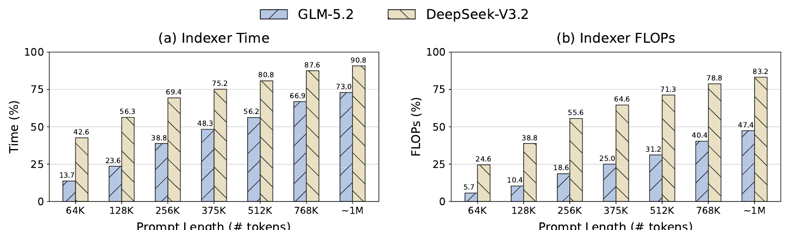
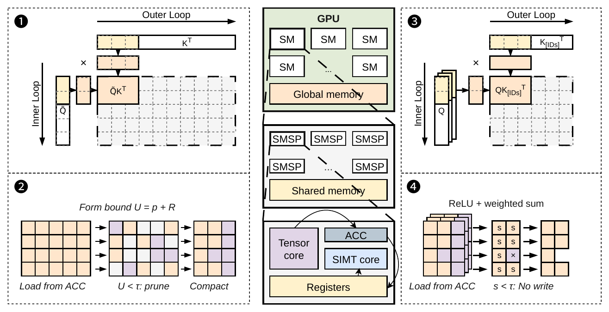
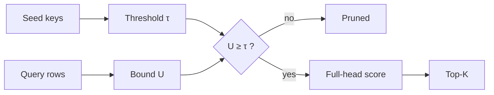

A post is a folder under `content/blog/` with an `index.md` and its figures, videos, and PDF beside it. The header above comes entirely from front matter: `title`, `subtitle`, `authors`, `affiliations`, `notes`, and `links`. The strip under the authors is generated from the title, so every post gets its own pattern; set `accent: coral` (or `butter`, `sky`, `lilac`) to change its second color, or `mask: false` to hide it.

Body text is Newsreader at 20px with a 42rem measure. Headings, captions, and interface text are Mona Sans. Text links look [like this](#links-and-footnotes), and **strong** and *emphasis* read as you would expect.

## Headings

Use `##` for sections and `###` for subsections. Both appear in the contents list, which shows as a collapsible box on narrow screens and as a rail in the left margin on wide ones. Hovering a heading shows a `#` link to it.

### A subsection

#### A fourth-level heading

Fourth-level headings are not listed in the contents.

## Math

Math is rendered to HTML when the site builds, so pages load no math JavaScript. Write inline math between single dollar signs: for query $\mathbf{q}_h$, weight $w_h$, and key $\mathbf{k}_i$, the indexer score is $s_i = \sum_h w_h [\mathbf{q}_h^\top \mathbf{k}_i]_+$. Display math goes between double dollar signs on their own lines, and `\tag{}` numbers it:

$$
U_i = \sum_{j \in R} \tilde{w}_j \left[\mathbf{q}_j^\top \mathbf{k}_i\right]_+ + E_P \lVert \mathbf{k}_i \rVert_2 - \left[\mathbf{a}_A^\top \mathbf{k}_i\right]_+, \qquad s_i \le U_i. \tag{9}
$$

Multi-line derivations use `aligned`:

$$
\begin{aligned}
D_{\text{base}} &= H (N_0 + N_s), \\
D_{\text{DoSA}} &= H N_0 + (r + d_a) N_s + H M.
\end{aligned}
$$

A literal dollar sign needs a backslash: \$5.

## Figures

An image on its own line becomes a numbered figure, and its title becomes the caption. Captions take Markdown and math.

```markdown

```


Add `{.wide}` on the next line to widen a figure past the text column. Use this for diagrams with small labels.


{.wide}

For a longer caption, use the `figure` shortcode, with the caption as its body:

```markdown

Complete-Indexer speedup over **SGLang** across context lengths, input domains,
and prefill chunk sizes. DoSA is fastest in all 60 configurations.

```


Complete-Indexer speedup over **SGLang** across context lengths, input domains, and prefill chunk sizes. DoSA is fastest in all 60 configurations, with gains above $2\times$ at 512K tokens and beyond.


Side-by-side panels share one caption with `row`. Each panel takes a short label.

```markdown




```






## Video

The `video` shortcode plays a file from the post folder, or embeds YouTube or Bilibili. With `autoplay=true` a clip loops silently, like a GIF; otherwise it shows controls.

```markdown



```



## Tables

Tables are drawn with three rules, as in a paper. Put attributes on the line after the table to add a numbered caption or widen it. Align numeric columns right with `---:`.

| Certificate variant | Surviving candidates | Indexer latency vs. DoSA |
| :--- | ---: | ---: |
| DoSA | **2.65%** | **1.000×** |
| All negative heads in the aggregate | 4.06% | 1.120× |
| No negative aggregate | 95.06% | 9.507× |
{caption="Certificate ablation on GLM-5.2, from the DoSA paper."}

## Code

Fenced code blocks get a label and a copy button. Name a file with `file=`, highlight lines with `hl_lines`, and number them with `linenos=true`.

````markdown
```python {file="indexer.py" hl_lines="6-7"}
...
```
````

```python {file="indexer.py" hl_lines="6-7"}
import torch

def indexer_scores(q, k, w):
    """Signed multi-head indexer score for every visible key.

    q: [H, D] query rows, k: [N, D] keys, w: [H] head weights.
    """
    return (w[:, None] * torch.relu(q @ k.T)).sum(0)

def topk_exact(q, k, w, K=2048):
    return indexer_scores(q, k, w).topk(K).indices
```

CUDA, C++, Triton, and shell are labeled and highlighted too:

```cuda {linenos=true}
// Reject a key when its certified upper bound falls below the seed threshold.
__global__ void screen(const float* __restrict__ U, float tau,
                       uint32_t* __restrict__ mask, int n) {
  int i = blockIdx.x * blockDim.x + threadIdx.x;
  bool keep = i < n && U[i] >= tau;
  uint32_t ballot = __ballot_sync(0xffffffff, keep);
  if ((threadIdx.x & 31) == 0 && i < n) mask[i >> 5] = ballot;
}
```

```bash
git clone https://github.com/llm-sys/dosa-sglang
cd dosa-sglang && pip install -e "python[all]"
python -m sglang.launch_server --model zai-org/GLM-5.2 --tp 8 --enable-dosa
```

```diff
- scores = indexer(q, k)            # every key, every head
- topk = scores.topk(2048)
+ survivors = screen(q, k, tau)     # certified rejection
+ topk = refine(q, k[survivors], tau).topk(2048)
```

Diagrams written in Mermaid are drawn in the browser; the script loads only on pages that use one.



## Callouts

GitHub-style alerts become callouts. The type sets the color; text after the marker replaces the title.

```markdown
> [!NOTE]
> DoSA changes which scores are computed, never the scores themselves.
```

> [!NOTE]
> DoSA changes which scores are computed, never the scores themselves. Every surviving key receives its original full-head score.

> [!TIP] Reproducing the numbers
> Profile with prefix caching off. Cached prefixes skip the indexer and hide the cost it adds at long context.

> [!WARNING]
> Bounds computed with round-to-nearest are not sufficient. Upper bounds must be rounded upward, or exact selection can fail.

### Theorems and proofs

`THEOREM`, `PROPOSITION`, `LEMMA`, `COROLLARY`, `DEFINITION`, and `PROOF` render as formal blocks. Add `-` after the marker to collapse a block, or `+` to make it collapsible but open.

> [!THEOREM] Theorem 1 (Exact Top-$K$ selection)
> Let $\tau = \tau_K(\mathcal{S})$ come from at least $K$ distinct visible keys scored by the original scorer. If every key rejected during screening satisfies $s_i \le U_i < \tau$, the algorithm returns the same Top-$K$ as full-domain scoring.

> [!PROOF]-
> Consider any key $i \notin \mathcal{S} \cup C$. If screening rejects it, then $s_i \le U_i < \tau$. Otherwise its original score satisfies $s_i < \tau$. In both cases
> $$
> s_i < \tau_K(\mathcal{S}) \le \tau_K(\Omega),
> $$
> so no discarded key can belong to the full-domain Top-$K$.

## Quotes and lists

> Sparse attention visits few keys, yet finding them can still require scoring every key with every indexer head.

Unordered lists:

- Fewer score computations: keys whose bound falls below the threshold skip full-head scoring.
- Fewer score writes: only scores at or above the threshold are written for selection.
- Less Top-$K$ work: selection runs on compact records instead of every score.

Ordered lists, for steps:

1. Choose at least $K$ distinct visible seed keys and score them.
2. Set the threshold $\tau$ to their $K$th largest score.
3. Screen every other key with its bound, then fully score the survivors.

A horizontal rule (`---`) marks a break:

---

## Links and footnotes

Footnotes use `[^1]` in the text and `[^1]: ...` anywhere below.[^seed] They collect at the end of the post.[^fp8] Link to another post with its path, like [the DoSA post](/blog/dosa), and to a section of this page with its heading anchor, like [Math](#math).

[^seed]: A poor seed weakens filtering, but it never breaks exactness: additional exact scores can only raise the threshold's lower bound.
[^fp8]: The FP8 path adds numerical guards; see Appendix C of the paper.

## Front matter

```yaml {file="content/blog/my-post/index.md"}
---
title: "DoSA: Dots Sparse Attention"
subtitle: "One sentence under the title, also used for previews."
date: 2026-10-20
authors:
  - name: Fanxu Meng
    affil: [1]          # index into affiliations
    marks: ["*"]        # extra superscripts
    url: https://...    # optional
affiliations:
  - Dots Studio, Xiaohongshu Inc.
notes:
  - { mark: "*", text: "Equal contribution." }
links:                  # buttons under the authors
  - { label: Paper, url: paper.pdf, icon: pdf }        # pdf, arxiv, github, video, data
  - { label: Code, url: "https://github.com/...", icon: github }
tags: [sparse attention]
accent: amber           # pattern color: amber, coral, butter, sky, lilac
arxiv: "2610.13990"     # optional, quoted; adds an arXiv button and cites arXiv
arxiv_class: cs.LG      # optional, primaryClass in the BibTeX
citekey: meng2026dosa   # BibTeX key; or give a full `bibtex:` block
# toc: false            # hide the contents list
# citation: false       # hide the citation block
# figure_numbers: false # drop "Figure 1" labels
---
```

The citation block at the end of every post is generated. With `arxiv` set, it cites the arXiv entry; without it, it cites the blog post itself, as on this page. A `bibtex:` block in front matter replaces either with your own entry.
